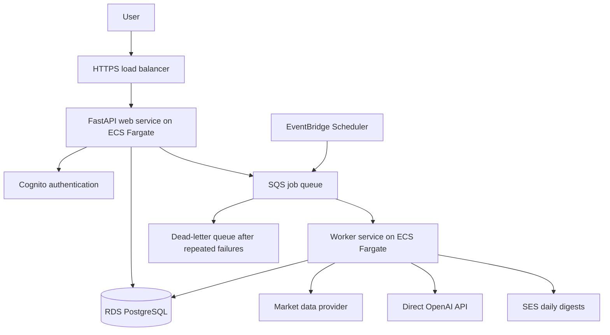

# StockPilotAI AWS architecture

Decision date: October 16, 2026

Updated: October 21, 2026 — phased deployment for limited initial traffic.

Feature branch: `codex/aws-integration`

Status: Initial Lightsail infrastructure and release files are prepared in
`infra/` and `deploy/lightsail/`; no AWS deployment has been performed. Production
infrastructure and hosted product features remain planned. See
[the preparation and deployment runbook](../infra/README.md).

## Product scope

Evolve the local application into a hosted service where users can sign in,
follow stocks, request analyses, view report history, and receive daily updates.
“Stock subscription” means following a stock; paid plans are a later feature.

## Architecture decisions

The table and diagram below describe the production target. Start with the
lower-cost Lightsail environment described next, then introduce staging that uses
the production architecture before releasing on ECS/Fargate and RDS.

| Area | Decision | Rationale |
| --- | --- | --- |
| Application | Keep FastAPI, the existing server-rendered interface, and REST APIs | Reuse the working application; GraphQL is not needed for the initial feature set. |
| Container management | Amazon ECS | Deploy and maintain web and worker services. |
| Compute | AWS Fargate | Run containers without managing EC2 hosts. |
| HTTPS ingress | Application Load Balancer with an ACM certificate | Route HTTPS requests to the web service. |
| Database | Amazon RDS PostgreSQL | Store application users, stock subscriptions, reports, jobs, and delivery history. |
| Authentication | Amazon Cognito user pool | Delegate credentials and authentication while retaining application user management in PostgreSQL. |
| Background work | Amazon SQS and an ECS/Fargate worker | Analysis must survive web deployments and support retries. |
| Daily schedule | EventBridge Scheduler | Trigger the daily reporting workflow. |
| Email | Amazon SES | Send login email as configured through Cognito and daily report digests. |
| LLM access | Keep the direct OpenAI API integration | Avoid changing the working model integration during cloud migration. Bedrock is optional later. |
| Container registry | Amazon ECR | Store immutable, versioned deployment images. |
| Secrets | AWS Secrets Manager | Store the OpenAI API key and database credentials. |
| Operations | CloudWatch and AWS budget alerts | Observe failures, queue backlog, application health, and spending. |
| Infrastructure as code | AWS CDK in Python, deploying CloudFormation, for both initial Lightsail and later ECS/RDS environments | Keep repeatable infrastructure definitions in the repository from the first deployment. |
| CI/CD | GitHub Actions with AWS OIDC | Deploy using temporary AWS credentials rather than permanent access keys. |

ECS and Fargate are complementary: ECS manages containers and Fargate provides
their compute. No separately managed EC2 host is required.



The scheduler queues a daily orchestration job. The worker expands it into stock
analysis jobs, then prepares user digests when the relevant reports are ready.
The web service and worker can share a Docker image with different entry commands.

## Initial environment and production transition

### Phase 1: Restricted development/demo on Lightsail

- Use one Linux Lightsail instance in the confirmed selected Region,
  **us-east-2 (Ohio)**. Start with 2 GB RAM; measure memory and CPU before resizing.
- Provision the Lightsail infrastructure through a dedicated CloudFormation
  stack generated by AWS CDK in Python. Keep the instance, static IP and its
  attachment, and supported network/access configuration in version-controlled
  infrastructure definitions. Parameterize environment-specific settings and
  review stack changes before applying them.
- Run FastAPI, PostgreSQL, and a Caddy HTTPS reverse proxy with Docker Compose.
  Caddy obtains and renews a free certificate for the configured domain.
- CloudFormation manages AWS infrastructure; a version-controlled bootstrap and
  deployment process installs Docker and deploys the Compose services. Application
  image releases and Alembic migrations are explicit deployment steps, rather
  than relying on instance creation to perform every subsequent release. Keep
  secret values out of templates and bootstrap scripts. Review replacements and
  deletion behavior carefully to preserve database storage and backups.
- Keep PostgreSQL on persistent host storage mounted into the container; do not
  expose its port publicly. Use cloud-specific credentials rather than the local
  development credentials in the existing Compose file.
- Restrict app access until authentication and authorization are implemented.
  Keep secrets out of Git and images, encrypt storage, automate database backups
  outside the server, and test restoration. Limit backup and log retention.
- Defer the load balancer, NAT gateway, RDS, and separate worker service. The
  current in-process analysis jobs may be interrupted by restarts; this is an
  accepted limitation for this restricted environment, not the durable-job design.
- Reuse saved reports where appropriate and limit analysis concurrency and model
  usage to control direct OpenAI spending.

Planning estimate checked October 21, 2026: the Ohio Lightsail bundle is
**$12/month** for 2 GB RAM, 60 GB SSD, one public IPv4 address, and an included
transfer allowance. Budget **$15–20/month before AWS credits** with modest backup
and operational usage. Domain registration, taxes, OpenAI charges, and usage
beyond the bundle are additional. Lightsail continues billing when stopped.
These are estimates, not a spending cap or measured application capacity.

AWS reported an active Free plan and **$200 remaining credits** on October 21,
2026, with a plan end date of April 18, 2027 (Pacific time). Credits offset
eligible AWS usage, not direct OpenAI charges. Recheck balance, eligibility, plan
status, and spend status in AWS Settings > Billing before deployment; do not
assume credits extend the Free plan. No resources have been deployed by this plan.

### Phase 2: Production and representative staging

When introducing production on ECS/Fargate and RDS, create a separate staging
environment using the **same CDK definitions, service types, configuration
patterns, and release process**. Lightsail may remain a development/demo server
if useful, but it is no longer the final production release gate. It cannot
validate ECS networking, task IAM permissions, load-balancer behavior, or RDS
connectivity.

- Staging may use one small web task and Single-AZ RDS while production adds
  tasks and database redundancy according to availability needs. An Application
  Load Balancer requires subnets in at least two Availability Zones within Ohio;
  this does not require duplicating every app or database instance.
- Keep staging and production data, credentials, secrets, and AWS resources
  separate. Deploy the same tested immutable image to each environment.
- For occasional release testing, create staging on demand and remove its
  disposable resources afterward. Stopping compute alone does not remove load
  balancer, storage, backup, or retained public-IP charges. Preserve any required
  data and explicitly scope teardown so production is protected.
- The earlier small Fargate/ALB/RDS estimate was **$55–65/month** for an always-on,
  lightly used environment before credits, excluding domain, tax, and OpenAI.
  It is a baseline for the current app, not a quote for the full worker/email
  product or highly available production. Reprice the final resource set.

### Migration preparation and release

Keep the same Docker build and PostgreSQL/Alembic schema workflow across phases.
Externalize database URLs, secrets, and environment-specific settings. Durable
application state must stay outside the app container. Container architecture
must match the selected compute; build for the target platform when necessary.

Before production cutover, implement authentication and per-user ownership,
durable background jobs, and required data-provider licensing. Provision the
target infrastructure, rehearse database backup/restore into RDS if existing data
must be retained, and validate in representative staging. Run migrations and
deploy the tested image to production; switch the production DNS record after
verification. Plan a write pause/final data transfer where needed and a rollback
that accounts for database changes. This is a planned deployment and migration,
not an automatic hosting upgrade.

## Identity and user data

- Start with email one-time-code login. SMS codes can be added as an optional
  sign-in method; both can access the same account once the contacts are linked
  and verified.
- Cognito passwordless email/SMS authentication requires Essentials or Plus and
  the app client's `ALLOW_USER_AUTH` flow.
- A fully passwordless signup experience requires our own signup form using
  Cognito's SDK. At the decision date, Cognito's managed signup page still asks
  for a password even when passwordless login is enabled.
- Email/SMS first-factor OTP login is not MFA and is incompatible with a user
  pool that requires MFA. Decide any stronger administrator authentication
  requirements separately.
- Configure SES production sending. SMS additionally needs delivery setup,
  production access, applicable sender registration, and spending/abuse controls.
- PostgreSQL owns the application profile, preferences, subscriptions, and access
  rules. Use an internal user ID linked to the identity provider's issuer and
  subject identifier; do not use an email address as a permanent identity key.
- Enforce user ownership in business logic for every private HTML and API route.
  Cognito authenticates users; it does not implement report-level authorization.
- Implement secure application sessions, logout, CSRF protection where applicable,
  and safe contact-change/account-linking flows. Never automatically merge accounts
  solely because a submitted email or phone number appears to match.

## Database and report design

Use PostgreSQL on Lightsail for the initial restricted environment, then RDS
PostgreSQL for the production architecture, rather than Aurora. Single-AZ is suitable for
staging or a beta that accepts downtime. Select Multi-AZ for production if the
availability requirement warrants it. Aurora remains an option if measured load,
capacity variability, or availability requirements justify it; migration would
require planning and validation, not just a configuration switch.

Suggested entities:

- `users` and identity-provider links
- `stock_subscriptions` and notification preferences
- market-data snapshots and shared stock reports
- user-specific analysis requests/results
- jobs and job attempts
- digest deliveries and delivery status

Keep commonly filtered fields such as user ID, symbol, report date, status, and
action in normal columns. Use JSON/JSONB for detailed snapshots and analysis
payloads. Apply uniqueness constraints for subscriptions and logical jobs.

Generate shared research once per stock, data snapshot, and analysis configuration.
Include relevant model/prompt versions in reuse keys. Existing conclusions depend
on investment horizon, ownership, and peer selection, so personalized conclusions
must remain separate or use appropriately distinct configuration keys.

## Reliable background processing

Replace the current in-process background thread work with persisted jobs and SQS.
Web requests should return a job ID/status promptly rather than wait for the full
analysis. The current JSON creation API is synchronous; plan compatibility when
introducing asynchronous behavior.

- Use a transactional outbox or equivalent recovery mechanism so a saved job
  cannot silently be lost between the database write and queue publication.
- SQS can deliver duplicates. Use idempotent job handling, atomic claims, and
  uniqueness constraints to avoid duplicate reports and unnecessary model calls.
- Configure visibility timeouts, extensions for long jobs, bounded retries, and
  a dead-letter queue. Record failure reasons and provide a retry path.
- Limit worker concurrency and per-user usage to control provider quotas and cost.
- Track email attempts separately from analysis completion. Reconcile ambiguous
  send outcomes; do not assume exactly-once email delivery.
- For the initial US-stock workflow, use a delivery window after market close,
  exchange-calendar logic for holidays/early closes, and explicit data timestamps.
- Show failed, partial, or stale reports honestly rather than presenting old data
  as a fresh daily analysis.

## Deployment and networking

The following task and load-balancer rules apply to the ECS/Fargate target;
the initial Lightsail environment follows the restrictions above. All Regional
resources stay in the selected Region, us-east-2; do not use cross-Region features.

Keep the database private. Restrict database access to application and migration
tasks. Restrict web-task ingress to the load balancer; workers need no public
inbound endpoint. Configure outbound access for OpenAI, market-data providers, and
required AWS services. Choose NAT and/or VPC endpoints deliberately after pricing
the network design; private subnets alone do not provide internet access.

Use separate staging and production configurations, least-privilege task roles,
encrypted storage, controlled secret access, automated backups, and restore tests.
Protect production database resources from accidental stack deletion/replacement.
Do not keep durable state on container-local filesystems.

```text
Pull request
  -> application tests + PostgreSQL integration tests
  -> Docker build + CDK synthesis/infrastructure validation

Merge/release
  -> build image once and push to ECR by immutable digest
  -> review/deploy infrastructure changes
  -> run a dedicated migration task with database access
  -> deploy staging and smoke-test
  -> release approval
  -> run production migrations and deploy the same tested image
  -> health checks and rollback on failed application deployment
```

Scope GitHub OIDC trust to the intended repository and branch/environment. Plan
the one-time AWS/CDK/OIDC bootstrap separately from routine application releases.
Use backward-compatible schema migrations; rolling back an application image does
not automatically undo a database migration.

## Implementation order

1. **Cloud readiness:** Test PostgreSQL locally; install the existing `cloud`
   dependency extra in Docker; use Alembic rather than startup `create_all` in
   production; externalize configuration and check health/shutdown behavior.
2. **Low-cost restricted environment:** Define the Lightsail infrastructure in
   Python CDK and deploy it through CloudFormation. Bootstrap Docker and deploy
   Compose services with PostgreSQL persistent storage, Caddy HTTPS, protected
   secrets, backups, limited log retention, and budget alerts. Validate CDK
   synthesis and review infrastructure changes. Keep access restricted. Reuse a
   reproducible Docker build and migration process for future environments.
3. **Accounts and ownership:** Integrate Cognito and application sessions; add
   user profiles and per-user access control. Test cross-user isolation.
4. **Durable jobs:** Add SQS and the worker, idempotency, retry/dead-letter handling,
   and job-status APIs. Test restarts and duplicate deliveries.
5. **Stock subscriptions and daily reports:** Add follow/unfollow, preferences,
   scheduling, shared research reuse, personalized results, and SES digests.
6. **Production infrastructure and representative staging:** Add shared CDK
   definitions for separate ECS/Fargate, ALB/HTTPS, RDS, ECR, secrets, and logging
   resources. Add GitHub Actions with AWS OIDC. Rehearse migration from Lightsail,
   validate releases in this staging environment, and deploy the same image to
   production. Use on-demand staging if continuous operation is unnecessary.
7. **Beta readiness:** Validate restore and deployment rollback, alerts, quotas,
   unsubscribe and bounce/complaint handling, and production data-provider rights.
8. **Later:** Consider paid subscriptions, mobile clients, GraphQL, Aurora, or
   Bedrock only when concrete requirements justify them.

## Initial deployment decisions still needed

- Selected Region is confirmed as us-east-2 (Ohio); choose the domain and final
  monthly infrastructure budget. Confirm the intended AWS project before deployment.
- Backup retention, acceptable data loss/recovery time, and whether representative
  staging should run continuously or only during release testing.
- Production availability target and Single-AZ versus Multi-AZ configuration.
- Initial user volume, stock count, daily delivery window, and usage limits.
- Market/news provider licensed for the intended public distribution. Current
  Yahoo adapters are for prototyping and should be replaced before public launch.
- Email sender identity and whether SMS belongs in the initial release.

## References

Capabilities and pricing should be rechecked when implementing.

- [AWS CDK and CloudFormation](https://docs.aws.amazon.com/cdk/v2/guide/home.html)
- [Lightsail pricing](https://aws.amazon.com/lightsail/pricing/)
- [ECS load balancing](https://docs.aws.amazon.com/AmazonECS/latest/developerguide/service-load-balancing.html)
- [RDS Multi-AZ](https://docs.aws.amazon.com/AmazonRDS/latest/UserGuide/Concepts.MultiAZ.html)
- [GitHub OIDC for AWS](https://docs.github.com/en/actions/how-tos/secure-your-work/security-harden-deployments/oidc-in-aws)
- [Cognito passwordless authentication configuration](https://docs.aws.amazon.com/cognito/latest/developerguide/authentication-flows-selection-sdk.html)
- [Cognito signup limitations](https://docs.aws.amazon.com/cognito/latest/developerguide/authentication-flow-things-to-know.html)
- [Cognito MFA restrictions](https://docs.aws.amazon.com/cognito/latest/developerguide/user-pool-settings-mfa.html)
- [SQS visibility and duplicate delivery](https://docs.aws.amazon.com/AWSSimpleQueueService/latest/SQSDeveloperGuide/sqs-visibility-timeout.html)
- [SES verified identities](https://docs.aws.amazon.com/ses/latest/dg/verify-addresses-and-domains.html)
- [OpenAI on Bedrock: optional future integration](https://developers.openai.com/api/docs/guides/amazon-bedrock)
