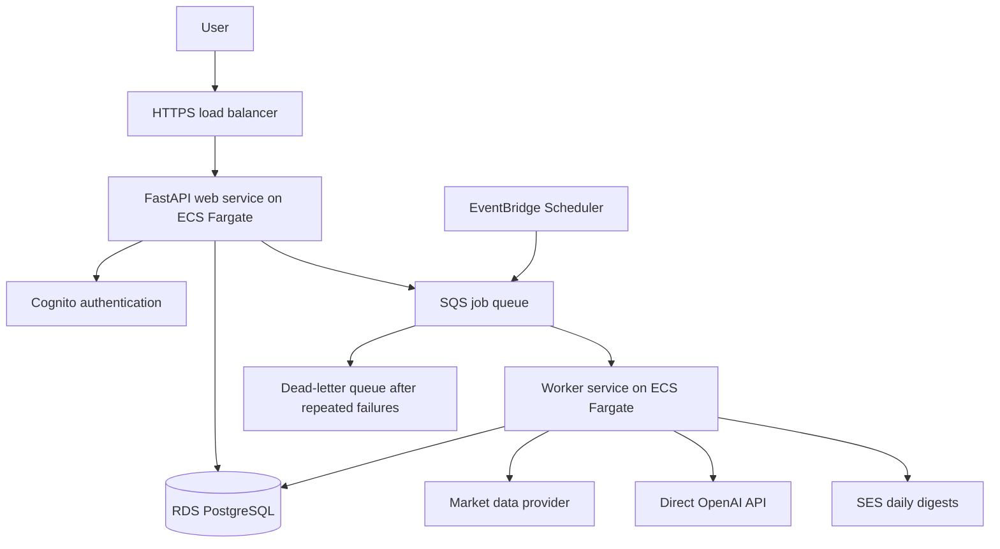

# StockPilotAI AWS architecture

Decision date: October 16, 2026

Feature branch: `codex/aws-integration`

Status: Agreed direction; infrastructure and product features are not yet implemented.

## Product scope

Evolve the local application into a hosted service where users can sign in,
follow stocks, request analyses, view report history, and receive daily updates.
“Stock subscription” means following a stock; paid plans are a later feature.

## Architecture decisions

| Area | Decision | Rationale |
| --- | --- | --- |
| Application | Keep FastAPI, the existing server-rendered interface, and REST APIs | Reuse the working application; GraphQL is not needed for the initial feature set. |
| Container management | Amazon ECS | Deploy and maintain web and worker services. |
| Compute | AWS Fargate | Run containers without managing EC2 hosts. |
| HTTPS ingress | Application Load Balancer with an ACM certificate | Route HTTPS requests to the web service. |
| Database | Amazon RDS PostgreSQL | Store application users, stock subscriptions, reports, jobs, and delivery history. |
| Authentication | Amazon Cognito user pool | Delegate credentials and authentication while retaining application user management in PostgreSQL. |
| Background work | Amazon SQS and an ECS/Fargate worker | Analysis must survive web deployments and support retries. |
| Daily schedule | EventBridge Scheduler | Trigger the daily reporting workflow. |
| Email | Amazon SES | Send login email as configured through Cognito and daily report digests. |
| LLM access | Keep the direct OpenAI API integration | Avoid changing the working model integration during cloud migration. Bedrock is optional later. |
| Container registry | Amazon ECR | Store immutable, versioned deployment images. |
| Secrets | AWS Secrets Manager | Store the OpenAI API key and database credentials. |
| Operations | CloudWatch and AWS budget alerts | Observe failures, queue backlog, application health, and spending. |
| Infrastructure as code | AWS CDK in Python, deploying CloudFormation | Keep repeatable infrastructure definitions in the repository. |
| CI/CD | GitHub Actions with AWS OIDC | Deploy using temporary AWS credentials rather than permanent access keys. |

ECS and Fargate are complementary: ECS manages containers and Fargate provides
their compute. No separately managed EC2 host is required.



The scheduler queues a daily orchestration job. The worker expands it into stock
analysis jobs, then prepares user digests when the relevant reports are ready.
The web service and worker can share a Docker image with different entry commands.

## Identity and user data

- Start with email one-time-code login. SMS codes can be added as an optional
  sign-in method; both can access the same account once the contacts are linked
  and verified.
- Cognito passwordless email/SMS authentication requires Essentials or Plus and
  the app client's `ALLOW_USER_AUTH` flow.
- A fully passwordless signup experience requires our own signup form using
  Cognito's SDK. At the decision date, Cognito's managed signup page still asks
  for a password even when passwordless login is enabled.
- Email/SMS first-factor OTP login is not MFA and is incompatible with a user
  pool that requires MFA. Decide any stronger administrator authentication
  requirements separately.
- Configure SES production sending. SMS additionally needs delivery setup,
  production access, applicable sender registration, and spending/abuse controls.
- PostgreSQL owns the application profile, preferences, subscriptions, and access
  rules. Use an internal user ID linked to the identity provider's issuer and
  subject identifier; do not use an email address as a permanent identity key.
- Enforce user ownership in business logic for every private HTML and API route.
  Cognito authenticates users; it does not implement report-level authorization.
- Implement secure application sessions, logout, CSRF protection where applicable,
  and safe contact-change/account-linking flows. Never automatically merge accounts
  solely because a submitted email or phone number appears to match.

## Database and report design

Use RDS PostgreSQL initially, rather than Aurora. Single-AZ is suitable for
staging or a beta that accepts downtime. Select Multi-AZ for production if the
availability requirement warrants it. Aurora remains an option if measured load,
capacity variability, or availability requirements justify it; migration would
require planning and validation, not just a configuration switch.

Suggested entities:

- `users` and identity-provider links
- `stock_subscriptions` and notification preferences
- market-data snapshots and shared stock reports
- user-specific analysis requests/results
- jobs and job attempts
- digest deliveries and delivery status

Keep commonly filtered fields such as user ID, symbol, report date, status, and
action in normal columns. Use JSON/JSONB for detailed snapshots and analysis
payloads. Apply uniqueness constraints for subscriptions and logical jobs.

Generate shared research once per stock, data snapshot, and analysis configuration.
Include relevant model/prompt versions in reuse keys. Existing conclusions depend
on investment horizon, ownership, and peer selection, so personalized conclusions
must remain separate or use appropriately distinct configuration keys.

## Reliable background processing

Replace the current in-process background thread work with persisted jobs and SQS.
Web requests should return a job ID/status promptly rather than wait for the full
analysis. The current JSON creation API is synchronous; plan compatibility when
introducing asynchronous behavior.

- Use a transactional outbox or equivalent recovery mechanism so a saved job
  cannot silently be lost between the database write and queue publication.
- SQS can deliver duplicates. Use idempotent job handling, atomic claims, and
  uniqueness constraints to avoid duplicate reports and unnecessary model calls.
- Configure visibility timeouts, extensions for long jobs, bounded retries, and
  a dead-letter queue. Record failure reasons and provide a retry path.
- Limit worker concurrency and per-user usage to control provider quotas and cost.
- Track email attempts separately from analysis completion. Reconcile ambiguous
  send outcomes; do not assume exactly-once email delivery.
- For the initial US-stock workflow, use a delivery window after market close,
  exchange-calendar logic for holidays/early closes, and explicit data timestamps.
- Show failed, partial, or stale reports honestly rather than presenting old data
  as a fresh daily analysis.

## Deployment and networking

Keep the database private. Restrict database access to application and migration
tasks. Restrict web-task ingress to the load balancer; workers need no public
inbound endpoint. Configure outbound access for OpenAI, market-data providers, and
required AWS services. Choose NAT and/or VPC endpoints deliberately after pricing
the network design; private subnets alone do not provide internet access.

Use separate staging and production configurations, least-privilege task roles,
encrypted storage, controlled secret access, automated backups, and restore tests.
Protect production database resources from accidental stack deletion/replacement.
Do not keep durable state on container-local filesystems.

```text
Pull request
  -> application tests + PostgreSQL integration tests
  -> Docker build + CDK synthesis/infrastructure validation

Merge/release
  -> build image once and push to ECR by immutable digest
  -> review/deploy infrastructure changes
  -> run a dedicated migration task with database access
  -> deploy staging and smoke-test
  -> release approval
  -> run production migrations and deploy the same tested image
  -> health checks and rollback on failed application deployment
```

Scope GitHub OIDC trust to the intended repository and branch/environment. Plan
the one-time AWS/CDK/OIDC bootstrap separately from routine application releases.
Use backward-compatible schema migrations; rolling back an application image does
not automatically undo a database migration.

## Implementation order

1. **Cloud readiness:** Test PostgreSQL locally; install the existing `cloud`
   dependency extra in Docker; use Alembic rather than startup `create_all` in
   production; externalize configuration and check health/shutdown behavior.
2. **Restricted staging and CI/CD:** Add CDK, ECR, ECS/Fargate, RDS, HTTPS, secrets,
   logging, backups, budget alerts, and GitHub Actions. Keep staging access
   restricted until authentication and authorization are implemented.
3. **Accounts and ownership:** Integrate Cognito and application sessions; add
   user profiles and per-user access control. Test cross-user isolation.
4. **Durable jobs:** Add SQS and the worker, idempotency, retry/dead-letter handling,
   and job-status APIs. Test restarts and duplicate deliveries.
5. **Stock subscriptions and daily reports:** Add follow/unfollow, preferences,
   scheduling, shared research reuse, personalized results, and SES digests.
6. **Beta readiness:** Validate restore and deployment rollback, alerts, quotas,
   unsubscribe and bounce/complaint handling, and production data-provider rights.
7. **Later:** Consider paid subscriptions, mobile clients, GraphQL, Aurora, or
   Bedrock only when concrete requirements justify them.

## Initial deployment decisions still needed

- AWS account, region, domain, and monthly infrastructure budget.
- Production availability target and Single-AZ versus Multi-AZ configuration.
- Initial user volume, stock count, daily delivery window, and usage limits.
- Market/news provider licensed for the intended public distribution. Current
  Yahoo adapters are for prototyping and should be replaced before public launch.
- Email sender identity and whether SMS belongs in the initial release.

## References

Capabilities and pricing should be rechecked when implementing.

- [AWS CDK and CloudFormation](https://docs.aws.amazon.com/cdk/v2/guide/home.html)
- [ECS load balancing](https://docs.aws.amazon.com/AmazonECS/latest/developerguide/service-load-balancing.html)
- [RDS Multi-AZ](https://docs.aws.amazon.com/AmazonRDS/latest/UserGuide/Concepts.MultiAZ.html)
- [GitHub OIDC for AWS](https://docs.github.com/en/actions/how-tos/secure-your-work/security-harden-deployments/oidc-in-aws)
- [Cognito passwordless authentication configuration](https://docs.aws.amazon.com/cognito/latest/developerguide/authentication-flows-selection-sdk.html)
- [Cognito signup limitations](https://docs.aws.amazon.com/cognito/latest/developerguide/authentication-flow-things-to-know.html)
- [Cognito MFA restrictions](https://docs.aws.amazon.com/cognito/latest/developerguide/user-pool-settings-mfa.html)
- [SQS visibility and duplicate delivery](https://docs.aws.amazon.com/AWSSimpleQueueService/latest/SQSDeveloperGuide/sqs-visibility-timeout.html)
- [SES verified identities](https://docs.aws.amazon.com/ses/latest/dg/verify-addresses-and-domains.html)
- [OpenAI on Bedrock: optional future integration](https://developers.openai.com/api/docs/guides/amazon-bedrock)
